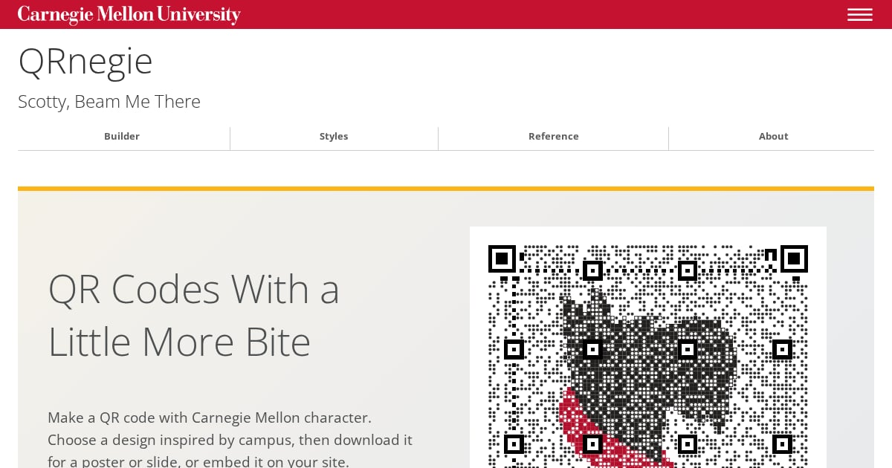

# QRnegie

QRnegie draws QR codes for Carnegie Mellon posters, slides and pages with
Carnegie Mellon character, from a Scotty portrait to Wean Hall's turtle
eating a Cheeto, as an SVG or PNG.

Site: https://qrnegie.andrew.cmu.edu/

## Use It

Put the text to encode, a style and an image width in the URL (e.g.,
`https://qrnegie.andrew.cmu.edu/qr.svg?text=https%3A%2F%2Fwww.cmu.edu%2F&style=mosaic&width=1024`)
and use it wherever you need an image. The builder lets you preview the
code, download it and copy its URL or HTML. In Ruby and Rails, the
`cmu-web-qrnegie` gem builds the same addresses; see
[its README](packages/ruby/README.md).

QRnegie encodes your text exactly as entered, with no redirect or
tracking, so a downloaded code keeps working without QRnegie. Every style
is tested by decoding the finished image.

### Start With What You're Building

- **A poster or slide:** [Build a QR code and download it](https://qrnegie.andrew.cmu.edu/builder.html).
- **A web page:** [Use an image address](https://qrnegie.andrew.cmu.edu/reference.html).
- **A contact card, event or Wi-Fi network:** [Choose a content type in the Builder](https://qrnegie.andrew.cmu.edu/builder.html).
- **A project with an AI agent:** [Connect the MCP server](https://qrnegie.andrew.cmu.edu/reference.html#mcp).

The docs cover styles, sizes and file types, plus
[where the styles come from](https://qrnegie.andrew.cmu.edu/about.html).
