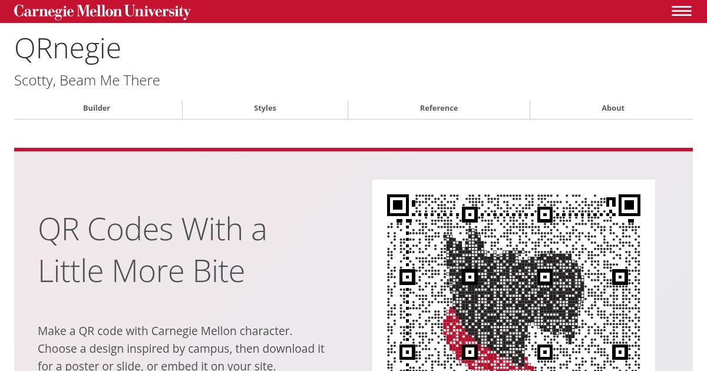

# QRnegie

**Scotty, Beam Me There**

QR Codes With a Little More Bite

Making a QR code for a CMU poster, slide or page? QRnegie draws it with
Carnegie Mellon character, from a Scotty portrait to Wean Hall's turtle
eating a Cheeto, as an SVG or PNG.

**[Explore the Documentation](https://qrnegie.andrew.cmu.edu/)** ·
[Build a QR Code](https://qrnegie.andrew.cmu.edu/builder.html) ·
[Explore the Styles](https://qrnegie.andrew.cmu.edu/styles.html)

Put the text to encode, a style and an image width in the URL, like
`https://qrnegie.andrew.cmu.edu/qr.svg?text=https%3A%2F%2Fwww.cmu.edu%2F&style=mosaic&width=1024`,
and use it wherever you need an image. The builder lets you preview the
code, download it and copy its URL or HTML.

QRnegie encodes your text exactly as entered, with no redirect or
tracking, so a downloaded code keeps working without QRnegie. Every style
is tested by decoding the finished image.

## Start With What You're Building

- **A poster or slide:** [Build a QR code and download it](https://qrnegie.andrew.cmu.edu/builder.html).
- **A web page:** [Use an image address](https://qrnegie.andrew.cmu.edu/reference.html).
- **A contact card, event or Wi-Fi network:** [Choose a content type in the Builder](https://qrnegie.andrew.cmu.edu/builder.html).
- **A project with an AI agent:** [Connect the MCP server](https://qrnegie.andrew.cmu.edu/reference.html#mcp).

The docs cover styles, sizes and file types, plus
[where the styles come from](https://qrnegie.andrew.cmu.edu/about.html).

## Help Improve QRnegie

[Report a problem or suggest a feature](https://github.com/cmu-web/cmu-web-qrnegie/issues),
or read the [contributing guide](CONTRIBUTING.md) to work on the service.
[Development](DEVELOPMENT.md) covers local setup and checks;
[Deployment](DEPLOYMENT.md) explains how to run your own instance.

## License

Copyright Carnegie Mellon University. The code uses the
[BSD 3-Clause License](LICENSE). CMU's names, marks and artwork, including
Scotty and the CMU heart, are not covered by that license. Kraus Campo's
numerals and the lettering above and below codes are outlines from Open
Sans, under the SIL Open Font License.
